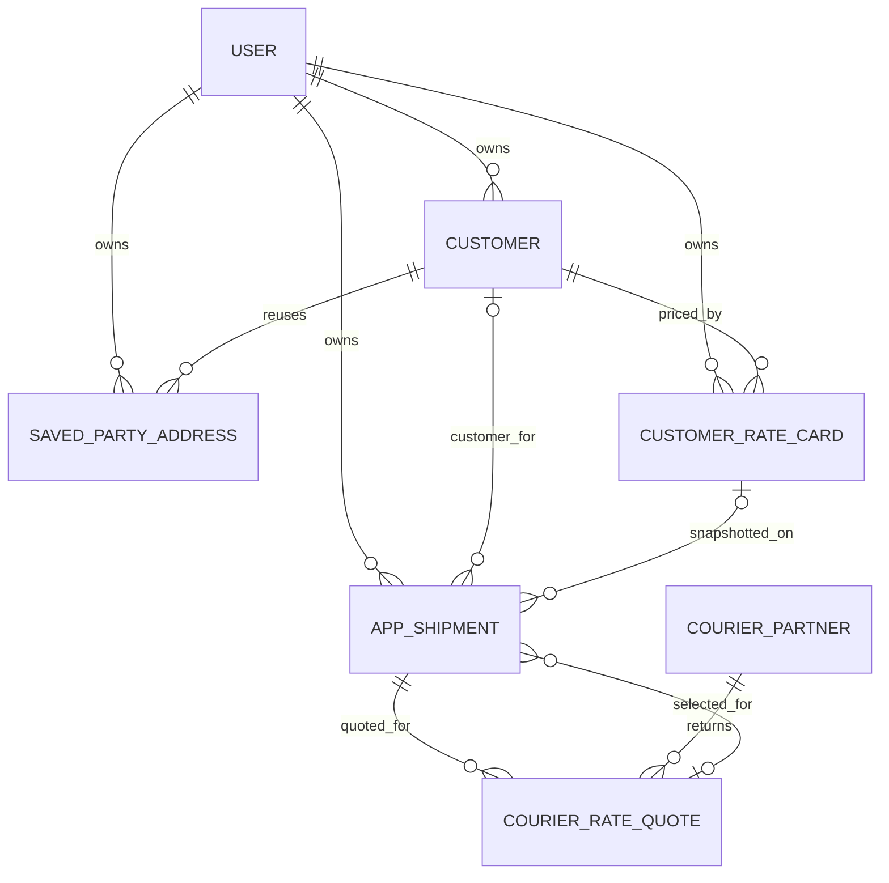

# Phase 1 — Milestone 1: Requirements and Data Contracts

**Status:** planning artifact only. No application code or data was changed.

**Authority:** Courier Management Software SRD v1.0, Sections 3–9 and Appendix A (pages 11–12). This report specifies proposed contracts; it does not decide unresolved client business rules or begin Milestone 2.

## 1. Workspace and current implementation reviewed

The backend workspace is `D:\delhivery-backebnd`; the full React application is in the adjacent workspace `D:\delhivery`. The backend also contains `frontend\api.mjs` and `frontend\README.md`, which are an API integration helper and wiring notes, not the React screen source. The complete SRD is `docs\Courier_Management_Software_SRD_V1.0.pdf`; the preceding plan is `docs\PHASE-1-TECHNICAL-IMPLEMENTATION-PLAN.txt`. A prior copy of this report was found at the backend root and relocated here after review. The requested deliverable is this file in the backend `docs` folder.

Current relevant implementation:

- **Frontend:** React workspace, shared API service, shipment form steps, warehouse/customer-facing shipment controls, shipment listing/detail. [API client](D:/delhivery/src/services/api.js), [create flow](D:/delhivery/src/pages/shipments/CreateShipmentPage.jsx), [workspace hook](D:/delhivery/src/hooks/useDemoWorkspace.js), [shipment list](D:/delhivery/src/pages/shipments/ShipmentsPage.jsx).
- **Backend:** Express routes, JWT session middleware, Mongoose, and a shared Delhivery Axios client. [Server mounts](D:/delhivery-backebnd/server.js), [Delhivery routes](D:/delhivery-backebnd/route/delhiveryroutes.js), [session middleware](D:/delhivery-backebnd/utils/requireSession.js), [carrier client](D:/delhivery-backebnd/services/delhiveryService.js).
- **Relevant persistence:** [AppShipment](D:/delhivery-backebnd/model/appShipment.js), [User](D:/delhivery-backebnd/model/model.js), and [PickupRequest](D:/delhivery-backebnd/model/pickupRequest.js). There is no customer, saved-party, customer-rate-card, courier-partner, or quote model.
- **Active shipment flow:** `/api/delhivery/shipments` is provided by [accountShipmentRoutes.js](D:/delhivery-backebnd/route/accountShipmentRoutes.js) and [appShipmentRouter.js](D:/delhivery-backebnd/services/appShipmentRouter.js), not the separate, simple [createShipmentController.js](D:/delhivery-backebnd/controller/createShipmentController.js). The active flow authenticates, reserves a unique owner/reference, submits to Delhivery, checks for a waybill, and saves a normalized record.
- **Current booking limits:** frontend shipment payloads map recipient/order/package/payment data to the Delhivery request in [api.js](D:/delhivery/src/services/api.js); shipping estimates compare Delhivery Surface/Express only. Package volumetric weight currently uses a fixed `/5000` formula in [PackageDetailsStep.jsx](D:/delhivery/src/components/shipments/steps/PackageDetailsStep.jsx). No customer tariff or shipment-time pricing snapshot is persisted.
- **Current ownership compatibility:** `AppShipment.owner` is a string and its unique index is `{ owner, reference }`. Its `state` is `creating|saved`, `kind` is `forward|reverse`, and `record` is `Mixed`. Preserve these meanings and legacy documents. The `User` model represents login users, not business customers.
- **Workspace state:** the backend initially showed this pre-existing report and the `docs` folder as untracked. The adjacent frontend Git status could not be inspected because Git rejected the workspace ownership as dubious; no Git settings were changed. No application source, package lock, database record, or carrier API was changed by this documentation task.

The SRD is the requirements authority. The technical plan narrows Phase 1 to its Sections 3–9 and Appendix A. Sections 10–16 and the later phases in Sections 17–18 are recorded below as explicit exclusions or dependencies so this contract does not silently expand Milestone 1.

## 2. Contract conventions

1. **Ownership:** every customer-owned record includes `owner`, using the authenticated user ID representation already used by `AppShipment` (`String`). All reads and writes must filter by `owner`; references alone are not authorization.
2. **Identity:** new entity IDs are MongoDB ObjectIds. References between new records use ObjectIds. Existing `AppShipment.reference` remains the business order reference and its unique `{ owner, reference }` index remains in force.
3. **Money:** persist numeric amounts as decimal-safe values (recommended representation: integer minor units) and persist the currency code. The exact currency, decimal precision, and rounding policy remain client decisions; current UI displays rupee values but that does not settle all rate rules.
4. **Dates:** store timestamps as BSON dates in UTC; the UI may display local time. Rate-card applicability must be snapshot-able at quote/booking time.
5. **Validation:** trim and bound strings; validate Indian pincode/phone formats where the relevant form requires them; reject non-finite/negative weights and amounts. Conditional requirements (such as GSTIN, COD amount, and credit details) depend on customer/payment category and must be agreed before coding.
6. **Provider responses:** store normalized quote fields plus a minimal provider response reference/metadata sufficient to trace a quote. Do not copy provider credentials into a quote, shipment, or response record. Full raw responses should be retained only if the client approves their storage and PII handling.
7. **Historical data:** new fields are optional for legacy shipments. Existing records must deserialize without backfill. Changing current customer or rate-card data must not rewrite a saved shipment’s quote, selling price, charges, or GST snapshot.

## 3. Proposed contracts and schema requirements

These are logical contracts for Milestone 1 agreement, not Mongoose code.

### 3.1 Customer

| Field | Required / validation | Purpose |
|---|---|---|
| `owner` | Required; indexed | Tenant boundary. |
| `category` | Required enum: `CREDIT`, `WALK_IN` | Implements the two SRD customer categories. Confirm spelling/API enum before implementation. |
| `companyName` / `displayName` | Requiredness to confirm; trimmed, bounded | Company or individual customer profile. |
| `primaryContact` | Contact name, phone, email; exact required fields to confirm | Credit profile and walk-in contact. |
| `gstin` | Optional/conditional; format validation to confirm | Customer GST registration. |
| `billingAddress` | Structured address; required for credit customer per SRD | Billing address. |
| `savedPartyAddressIds` | References to owned saved addresses | Reusable shipper/consignee/pickup data. |
| `rateCardId` | Required for pricing resolution; card scope must match category | Customer-specific credit card or standard walk-in card. |
| `creditTerms`, `creditLimit`, `monthlyBillingConfig` | Credit-only; detailed fields and units unresolved | Section 4 credit terms/limit and billing configuration. This stores configuration only; full invoicing is outside these Sections 3–9 data contracts. |
| `outstandingBalance` | SRD requires it; authoritative source/derived-vs-stored policy unresolved | Displayed account balance. Avoid treating a stale cached value as authoritative. |
| timestamps | Required by persistence | Record history. |

**Indexes/duplicates:** `{ owner, category, companyName }` may support lookup but must not be unique by default. The client must define what makes a customer unique (GSTIN, phone, customer code, or another key) before enforcing a unique index. Every lookup remains owner-scoped.

### 3.2 Saved shipper, consignee, and pickup addresses

Proposed separate `SavedPartyAddress` model to support reuse without treating a carrier warehouse as a customer address.

| Field | Required / validation | Purpose |
|---|---|---|
| `owner` | Required; indexed | Tenant boundary. |
| `customerId` | Optional reference to an owned Customer | Associates customer-specific parties; independent shipper/pickup records may have no customer link. Exact ownership model unresolved. |
| `partyType` | Required enum: `SHIPPER`, `CONSIGNEE`, `PICKUP` | Distinguishes SRD party/address roles. |
| `companyName`, `contactName` | Requiredness by party type unresolved | Business and named contact. |
| `phone`, `email` | Phone format if provided; email format if provided | Contact details. |
| `addressLines`, `city`, `state`, `pincode` | Address and city/state required; pincode required and validated for delivery/pickup | Destination/source details. |
| `gstin` | Optional/conditional | Shipper and consignee GST fields. |
| timestamps | Required | Saved profile maintenance. |

Do not use a `sameAsShipper` address document. That is a booking-form instruction to copy the selected shipper fields into pickup data; the stored booking should preserve the resulting pickup snapshot. No unique index on address or phone is proposed because multiple contacts may legitimately share either.

### 3.3 Customer Rate Card

Proposed `CustomerRateCard` model with nested rate rows.

| Field | Required / validation | Purpose |
|---|---|---|
| `owner` | Required; indexed | Tenant boundary. |
| `scope` | Required enum: `CUSTOMER`, `WALK_IN_STANDARD` | Separates customer-specific and standard retail cards. |
| `customerId` | Required for `CUSTOMER`; absent for walk-in standard | Associates credit-customer pricing. |
| `effectiveFrom`, `effectiveTo`, `version` | Dates/version recommended; overlap and activation rules unresolved | Identifies the tariff used at a point in time and supports historical snapshots. |
| `zoneRates[]` | Required rate rows; zone and mode required | Destination-zone pricing for Surface and Express. |
| `weightSlabs[]` | Lower/upper bound plus base rate and any additional slab charge | Weight-slab pricing. Boundary inclusivity and incremental calculation are unresolved. |
| `surcharges` | Fuel, COD, other applicable charges; each rule’s type/base unresolved | Captures Section 5 add-ons. |
| `gstRules` | Rates/inclusion flags/rounding not yet defined | Customer GST and final amount. |
| timestamps | Required | Card maintenance record. |

**Indexes/duplicates:** `{ owner, scope, customerId, effectiveFrom }` supports lookup. Enforce at most one applicable active card per customer/date only after the client defines effective-date and overlapping-card rules. Walk-in standard-card cardinality (one global per owner or multiple by mode/zone) is unresolved.

### 3.4 Courier Partner

Proposed `CourierPartner` registry plus a server-side adapter contract.

| Field | Required / validation | Purpose |
|---|---|---|
| `partnerCode` | Required, normalized; uniqueness scope unresolved | Stable adapter key, independent of display name. |
| `displayName` | Required | Name shown in comparison. |
| `adapterKey` | Required; allowlisted implementation key | Resolves serviceability, rate, and booking functions without provider-specific frontend code. |
| `enabled` | Required boolean | Controls whether a partner participates in a quote batch. |
| `capabilities` | Explicit set of supported SRD operations/modes | Allows graceful handling of unsupported API capabilities. |
| `credentialRef` / `configurationRef` | Secret reference only; never raw credentials in regular document | Selects deployment-managed credentials/configuration. Credential ownership/rotation mechanism unresolved. |
| timestamps | Required | Configuration history. |

Do not persist API keys in a client-visible document or return them to the frontend. Whether partner configuration is global to the deployment or scoped per business customer must be decided; existing Delhivery credentials are deployment-level environment configuration.

### 3.5 Courier Rate Quote

Proposed `CourierRateQuote` collection, related to a draft/booking and to a specific quote batch.

| Field | Required / validation | Purpose |
|---|---|---|
| `owner` | Required; indexed | Tenant boundary. |
| `shipmentId` | Required reference to the owner’s forward AppShipment draft/booking | Associates every quotation with its source shipment. Create/reserve the draft before requesting and storing quotes. |
| `quoteBatchId` | Required | Groups comparable quotes generated from the same shipment inputs. |
| `courierPartnerId`, `partnerCode` | Required | Partner identity and stable historical display. |
| `serviceCode`, `shippingMode` | Required where returned/supported | Surface/Express and partner service. |
| `serviceable` | Required boolean or explicit `UNKNOWN` state | Comparison eligibility; missing response is not equivalent to unserviceable. |
| `eta` | Optional normalized estimate and provider value/reference | ETA when partner supports it. |
| `chargeBreakdown`, `totalPartnerCost`, `currency` | Amounts nonnegative; currency required | SRD applicable charges and comparison total. Field semantics must be consistent across adapters. |
| `providerQuoteReference` | Optional | API response reference requested by Section 8. |
| `quotedAt`, `expiresAt` | Required timestamp / optional expiry | Quote freshness. Expiry period is client/provider-dependent. |
| `resultStatus`, `errorCode`, `errorMessage` | Required result state; exclude secrets | Records successful, unavailable, or failed partner response so partial batches remain explainable. |
| `responseMetadata` | Minimal/sanitized | Diagnostics without credentials or unnecessary PII. |

**Indexes/duplicates:** `{ owner, shipmentId, quoteBatchId }` for retrieval. Within a quote batch, a unique key on `{ shipmentId, quoteBatchId, courierPartnerId, serviceCode, shippingMode }` prevents duplicate results for the same service/mode in that batch. Refreshes create a new batch rather than overwriting previous quote history. A stable request/idempotency key should prevent duplicate quote-batch creation on a retry; retention policy is unresolved.

### 3.6 Shipment Draft and booking lifecycle

Reuse `AppShipment` for forward drafts/bookings; do not introduce an unrelated second shipment collection unless implementation discovery shows a concrete blocker.

**Existing fields to retain:**

- `owner`, `reference`, `kind`, `waybill`, `record`, `receipt`, timestamps.
- Existing unique `{ owner, reference }` and list index `{ owner, state, createdAt, _id }`.
- Existing rows with missing `kind` remain treated as forward by current queries; preserve compatibility.

**Proposed additive contract:**

| Field | Required / validation | Purpose |
|---|---|---|
| `state` | Extend current persistence enum explicitly with `draft`; retain `creating` and `saved`; do not change current default | Persistence/reservation state. `creating` continues to mean a provider operation is in progress/uncertain; `saved` continues to mean persisted carrier result. |
| `bookingStatus` | `Draft`, `Booking Pending`, `Booked`, `AWB Generated` | SRD user-visible booking lifecycle; separate from delivery `record.status`. Exact transition semantics for `Booked` versus `AWB Generated` need confirmation. |
| `customerId`, `selectedRateCardId` | Optional for legacy; required on new booking as applicable | Customer and applied card references. |
| `selectedQuoteId`, `selectedCourierPartnerId`, `partnerBookingReference` | Optional until selection/booking; validate ownership and quote/shipment match | Manual selection and carrier booking association. |
| `bookingRequestKey` | Required for booking attempt; uniqueness scope to decide | Prevents duplicate AWB attempts on retried requests. |
| `pricingSnapshot` | Optional for legacy; required before new booking finalization | Immutable original quote, selling-rate, charges, tax, and profit inputs; definition below. |
| `record` | Retain existing format and add new normalized booking fields additively | Keeps current API consumers and history readable. |

**Lifecycle:** new booking is saved as `state=draft`, `bookingStatus=Draft`; quote batch is associated; user selects a quote; a conditional atomic transition sets `state=creating`, `bookingStatus=Booking Pending`; accepted booking with AWB persists `state=saved`, carrier reference, receipt, `bookingStatus=AWB Generated`. If the partner confirms booking without returning an AWB, the proposed `Booked` state may be used—but whether that response occurs must be verified from actual partner documentation. A provider timeout/ambiguous response must remain distinguishable from definite rejection and must not blindly retry AWB creation.

**Duplicate prevention:** retain the unique owner/reference index; draft creation reserves that same pair, so one owner cannot create a second forward booking with the same reference. Use an atomic state compare-and-set before booking and a stable request key. Never let a draft list include `kind=reverse`. Do not add a unique carrier/AWB index until existing values and carrier uniqueness scope are audited; it may collide with existing records.

### 3.7 Immutable pricing and partner-selection snapshots

Store on `AppShipment.pricingSnapshot` (or an equally immutable referenced snapshot) rather than resolving old shipments from current rate cards.

| Snapshot part | Proposed fields | Required behavior |
|---|---|---|
| Shipment inputs | Origin/destination pincodes and zone, package rows, actual/volumetric/chargeable weights, selected payment/mode | Reproduce the tariff/quote input used at booking. |
| Customer tariff | Customer ID/category, rate-card ID/version, rate row/slab IDs, selling-rate inputs | Preserve the exact card and tariff version used. |
| Customer charge | Selling-rate components, applicable surcharges, GST components, final customer amount, currency | Keep selling revenue separate from carrier cost; no re-rating on later card changes. |
| Selected partner | Partner ID/code, selected quote ID/batch, service/mode, API quote total/breakdown, provider quote reference, quote time | Preserve manual selection and original quote. |
| Partner final cost | Initially absent/unknown; later final invoice amount, surcharges, tax/recoverable-tax components, source/reference, captured time | Preserve original quote separately; add final cost as a later cost record/reconciliation without overwriting the quote. Source and edit authority unresolved. |
| Profitability | Gross profit and margin percentage plus inputs/compute time | Implement SRD formula using customer selling revenue excluding GST and partner cost excluding recoverable GST. Persist input amounts so the result can be reproduced. |

SRD equations: `Gross Profit = Customer Selling Revenue (excluding GST) − Partner Courier Cost (excluding recoverable GST)`; `Profit Margin (%) = Gross Profit ÷ Customer Selling Revenue (excluding GST) × 100`. Behavior when revenue is zero, cost is unavailable, or taxes are not classified must be client-approved; do not fabricate a margin.

### 3.8 Cross-contract validation and invariants

These validations are proposed for the server boundary. Frontend validation is for usability only and cannot replace them.

| Contract | Required validation before persistence/use |
|---|---|
| All owner-scoped records | Derive `owner` from the verified JWT (`req.user.id`), never from request JSON. Require a non-empty canonical string. Reject or ignore client-supplied owner fields. Trim strings; reject empty required strings, unsupported enums, non-finite values, and over-limit strings/arrays. |
| Customer | Category must be `CREDIT` or `WALK_IN`. Validate email and Indian phone when present; validate six-digit Indian pincodes and GSTIN syntax when present. Require a structured billing address for a credit customer. Credit-only fields cannot be used to bypass category rules. Resolve `rateCardId` under the same owner and verify `CUSTOMER` scope/customer match for credit or `WALK_IN_STANDARD` scope for walk-in. |
| Saved party | `partyType` must be supported. Validate required address/contact fields by role; validate pincode, phone, email, and GSTIN formats where present. If `customerId` is set, require an owned customer and enforce the agreed association rule. Do not accept a foreign `customerId` even if the party itself is owned. |
| Rate card | Require a valid scope, currency, effective interval, non-empty rate rows, and non-negative monetary values. Each row needs a valid zone, mode, and slab; slab lower bound must be less than upper bound (or explicitly open-ended), and duplicate/overlapping zone-mode-weight intervals in one version must be rejected. Surcharge/GST rule type and required value must agree. Validate that customer scope and customer ID agree. |
| Courier partner | `partnerCode` and `adapterKey` must be normalized and selected from configured allowlists. Validate supported capabilities/modes. Configuration references must resolve only on the server; never accept a raw secret from ordinary CRUD or expose a secret in an API response. |
| Quote batch/result | Require owned forward shipment, matching batch/input version, known partner configuration and currency. `serviceable` must distinguish `TRUE`, `FALSE`, and `UNKNOWN`; a provider error is a result state, not a zero-cost quote. Require non-negative amounts, consistent currency and a defined total equal to the included charge components. A selectable quote must be successful, serviceable, unexpired under the agreed rule, and belong to the same owner, shipment, and batch. |
| Shipment draft/booking | New drafts require a non-empty trimmed business `reference`, valid party/package/payment/mode inputs and owner-matched customer/card. Package count and dimensions/weights must be positive and bounded; all packages need explicit units before normalization. `COD` requires a positive collection amount; prepaid must not accidentally carry a COD amount. Validate the selected quote against the draft's current input fingerprint/version. Enforce legal state transitions with atomic conditional updates. |
| Pricing/cost snapshot | Store amounts with a currency and explicit tax inclusion/classification. Keep API quote, final carrier invoice cost, customer selling charges, GST and computed profit inputs separate. Never mutate the initial quote or booked selling-rate snapshot when master data changes. No profit/margin value is valid when required revenue/cost/tax inputs are unknown or revenue is zero. |

Format and numeric policy still requiring client agreement: maximum lengths, exact phone/email/GSTIN acceptance policy, currency scale, weight precision, dimensions precision, rounding stage, maximum package rows/box count, and whether unknown optional provider fields are retained. The validations above specify safe invariants without inventing business amounts or provider requirements.

### 3.9 Index and duplicate-prevention matrix

All compound indexes below begin with the tenant key whenever records are tenant-owned. Exact MongoDB partial-index predicates and collation must be confirmed against production data before implementation.

| Collection / record | Proposed index or guard | Duplicate prevention / notes |
|---|---|---|
| `User` (existing) | Existing unique normalized email | Login identity is global in current code; not a customer uniqueness rule. |
| `Customer` | `{ owner, category, updatedAt }` for listing; optional non-unique normalized search indexes | No unique company/phone index until the client defines customer identity. If GSTIN/customer code is chosen, scope uniqueness to owner and handle absent/empty values with a partial unique index. |
| `SavedPartyAddress` | `{ owner, customerId, partyType, updatedAt }`; optionally `{ owner, partyType, pincode }` for lookup | No uniqueness by address, person, or phone; legitimate shared contacts/addresses are possible. |
| `CustomerRateCard` | `{ owner, scope, customerId, effectiveFrom }` | Unique version key `{ owner, scope, customerId, version }` is recommended when version semantics are accepted. Do not use a simple unique active-card index until overlap/effective-date rules are agreed. |
| `CourierPartner` | If deployment-global: unique normalized `partnerCode`; if tenant-configured: unique `{ owner, partnerCode }` | Choose one ownership model before adding the index. Never silently mix deployment-global and tenant-managed partner records. |
| `CourierRateQuote` | `{ owner, shipmentId, quoteBatchId }`; unique `{ owner, shipmentId, quoteBatchId, courierPartnerId, serviceCode, shippingMode }` when one result per service/mode is the confirmed contract | Make null/missing service-mode behavior explicit (e.g. normalized partner service key) so MongoDB null semantics do not create accidental collisions. Refresh creates a new batch. Idempotent batch request key uniqueness should be owner-scoped. |
| `AppShipment` (existing) | Preserve unique `{ owner, reference }`; preserve `{ owner, state, createdAt, _id }` | Existing unique business reference is the primary booking reservation. Reserve before any provider booking request. Avoid adding unique waybill index until carrier scope and existing data have been audited. |
| Booking attempt / AWB | Unique `{ owner, bookingRequestKey }` on persisted attempt key or enforce on `AppShipment`; compare-and-set shipment state before provider call | Repeated HTTP submit with the same key returns current attempt/result and never creates a second external booking. A distinct key cannot bypass an already active/uncertain attempt for that shipment. Do not blindly retry a timeout or ambiguous response. |

For two concurrent draft submissions with the same owner/reference, the database unique index must admit only one reservation. For two concurrent booking actions on one draft, exactly one conditional transition may leave `Draft`; the losing request returns the current state. A definite partner rejection and an ambiguous timeout must remain distinguishable. Reusing a reference after a definite failure/deletion is a client policy question; retaining a reservation is safer when the partner may have accepted the request.

## 4. Relationships and ownership

Every relationship resolution must prove that the referenced document belongs to the same `owner`. A quote from another shipment, owner, or quote batch cannot be selected. Saved pickup addresses are not `PickupRequest` records: the latter represent operational pickup scheduling and remain unchanged by this contract.

`CourierPartner` is the exception to the tenant-owned records shown above: the contract must choose either a deployment-global registry/configuration, or tenant-scoped partner accounts. If global, it has no customer-data `owner` and its stable identity is globally unique; every `CourierRateQuote` remains owner-scoped and snapshots the partner code/name. Credentials/configuration references remain server-side. If tenant-scoped, partner identity and configuration must be filtered by the authenticated owner. This deployment decision remains open; it does not weaken owner checks on customer, rate, shipment, or quote data.

## 5. Reuse and APIs to extend

- **Reuse `AppShipment`** and its owner/reference uniqueness and reservation flow; extend additively for draft and pricing/partner references. Preserve the existing `kind` split and saved-shipment list contract.
- **Reuse the Delhivery adapter foundation** in [delhiveryService.js](D:/delhivery-backebnd/services/delhiveryService.js) and existing Delhivery pincode, cost, manifestation, and label paths. Wrap these in a provider-neutral contract; do not replace existing routes in this milestone.
- **Reuse form building blocks** from the current shipment steps, [WarehouseFormDialog.jsx](D:/delhivery/src/components/warehouses/WarehouseFormDialog.jsx), and shared [API client](D:/delhivery/src/services/api.js). A warehouse is not a Customer or saved shipper profile; warehouse state currently uses local storage in [useSavedWarehouses.js](D:/delhivery/src/hooks/useSavedWarehouses.js).
- **Add authenticated owner-scoped APIs** for customer/saved-party CRUD, rate-card CRUD/resolution, quote-batch creation/retrieval, and draft create/list/get/update/book. Keep old `/api/delhivery/shipments` behavior available during transition.
- **Keep `User` as login identity.** Do not repurpose it as the customer master. `PickupRequest` is for scheduled carrier pickups and is not an address-book substitute.

## 6. SRD requirement-to-contract mapping

| SRD reference | Contract(s) | Current code coverage |
|---|---|---|
| §3.1 Destination pincode/city/state/zone/serviceability | AppShipment booking-input snapshot; quote serviceability by partner | Pincode/city/state exist; no zone record or multi-courier serviceability normalization. |
| §3.2 Shipper/consignor saved profile and GST | Customer + `SavedPartyAddress(SHIPPER)` | Missing as a reusable profile. Existing warehouse data is a separate carrier concept. |
| §3.3 Consignee saved for reuse | `SavedPartyAddress(CONSIGNEE)` | One-off shipment recipient fields exist; saved master missing. |
| §3.4 Same-as-shipper/new pickup | `SavedPartyAddress(PICKUP)` and booking input snapshot | Warehouse selection exists; alternate pickup contact/address and copy behavior missing. |
| §3.5 Packages, dimensions, handling, chargeable weight | Booking input/package snapshot; partner capability/weight rules | Multi-box and fixed volumetric calculation exist; partner-specific formula and complete mapped handling/package persistence missing. |
| §3.6 Prepaid/COD and Surface/Express | Booking input and pricing snapshot | Modes exist; COD amount currently equals order value in the Delhivery payload; separate rule unknown. |
| §4 Credit and walk-in customer profiles | `Customer`, saved parties, payment/balance fields | No customer master/category/rate assignment. Login `User` is not equivalent. |
| §5 Credit and walk-in rate masters | `CustomerRateCard` + immutable rate-card version snapshot | No persisted tariff rules or customer selling-price calculation. |
| §6 Multi-courier modular APIs | `CourierPartner`, adapter contract | One Delhivery-specific adapter/client only. |
| §7 Comparison, manual choice, all quotes retained | `CourierRateQuote`, selected quote/partner refs | Only Delhivery Surface/Express comparison; no cross-carrier persistence or manual partner selection. |
| §8 Quote, final cost, selling price, taxes, profit/margin, historic stability | `pricingSnapshot` and append-only final-cost data | Current normalized shipment records omit these separate monetary values and snapshots. |
| §9 Draft, resume, booking/AWB states and duplicate prevention | `AppShipment` additive state/status fields and booking request key | Existing reservation/idempotency foundation; no draft/resume or AWB-later path. |
| Appendix A screen sequence/actions | Form data contracts and lifecycle actions | Existing multi-section form is reusable but order/content differ and has one immediate-booking action. |

### 6.1 Explicit boundary for the rest of SRD v1.0

| SRD reference | Phase 1 relationship | Milestone 1 disposition |
|---|---|---|
| §10 Pickup Scheduling | Later operational pickup workflow; it consumes booked shipments and partner pickup capability | Out of this contract. Do not confuse `SavedPartyAddress(PICKUP)` with scheduled pickup requests. Existing `PickupRequest` remains separate. |
| §11 Credit Customer Monthly Billing | Uses customer billing settings, shipment selling-rate snapshots, and billable status | Billing documents, consolidated invoices, adjustments, payment receipts, due dates and payment status are Phase 3 per the plan; only the required customer configuration and shipment charge snapshot are represented here. |
| §12 Tracking and Exception Management | Depends on selected partner identity and booking references from Phase 1 | Tracking history, polling/webhook normalization, notifications, NDR/RTO and exception lifecycle are later operations scope; preserve extension points but define no new tracking contract in Milestone 1. |
| §13 Operations Dashboard | Depends on shipment lifecycle/tracking datasets | Later dashboard scope; no dashboard aggregate or API contract is added here. |
| §14 Financial Dashboard and Reports | Depends on invoices, final partner cost, payments, and profitability | Later finance/reporting scope. Phase 1 snapshots preserve source facts; this milestone does not define reports, exports, or accounting ledgers. |
| §15 Database and Historical Data Requirements | General cross-cutting retention/compatibility requirement | Apply immutable booking inputs/pricing and owner isolation now. API request/response logs, tracking/pickup history, invoices and payment records belong to their respective later modules; log retention and PII policy remain to be defined. |
| §16 General System Requirements | Authentication exists; roles, audit, backups, global search/retry may span multiple phases | Preserve authenticated ownership and duplicate protection in proposed contracts. Role-based permissions, audit trail, backups, global search, generic retry framework and complete API logs are not silently added to Milestone 1; record security/ops decisions below. |
| §17 Phased Development Approach | Phase 1 Core Booking; Phase 2 Operations; Phase 3 Finance; Phase 4 Advanced | Scope authority: this task proceeds only through Phase 1 Milestone 1 requirements/data contracts. No later milestone or phase starts. |
| §18 Development Notes | Architecture and partner API dependencies should be discovered progressively | Resolve client decisions and partner documentation before implementation; do not call live APIs or assume undocumented capabilities. |

The SRD's Phase 1 row names booking, customer management, rate master, comparison, AWB and draft booking. The plan decomposes this work into milestones and assigns this task only Milestone 1 (requirements/contracts). Fields that support a future module are included only where they are needed to preserve Phase 1 facts; they do not authorize that module's workflow.

## 7. Client questions that must remain open

1. **Customer identity/category:** What uniquely identifies a customer? Are walk-in customers persisted individually, or grouped under the standard walk-in account? Which profile fields are mandatory for each category?
2. **Party/address ownership:** Are shipper, consignee, and pickup addresses customer-specific, owner-wide, or both? May one saved party be reused by multiple customers? Which GSTIN/contact fields are conditionally required?
3. **Credit and outstanding balance:** What are credit terms/units and credit-limit behavior? Is outstanding balance sourced from another finance system, stored as a ledger result, or calculated? What does “monthly billing configuration” require in Phase 1 beyond storing its settings?
4. **Rate cards:** What are the authoritative zones and pincode mapping? Weight slab boundaries, minimum charge, additional-weight increments, and slab application? Are cards versioned/effective-dated, and may validity periods overlap? Is there exactly one standard walk-in card or multiple cards by zone/mode?
5. **Weight and packages:** Which volumetric divisor and rounding apply per carrier/service? Are package weights/dimensions charged individually or after aggregation? Which package categories and special-handling flags are required and supported by each partner?
6. **Money/tax:** Currency, precision, rounding stage, GST rates/inclusion, recoverable partner GST classification, and whether customer COD amount may differ from order value. How are fuel, COD, and “other” surcharges calculated and taxed?
7. **Partner configuration:** Which additional couriers are in Phase 1? Provide their official API docs, credentials/sandbox process, supported rate/serviceability/booking/label APIs, auth/signature requirements, field mappings, quote IDs, response/error examples, idempotency behavior, and rate/ETA limitations. Is partner configuration global or account-specific?
8. **Quote comparison:** What is the exact definition of “Total Partner Cost”? How long are quotes valid? What should happen for partial provider failures, unsupported modes, no ETA, or unserviceable results? Is historical delivery performance available now, or should the comparison show that criterion as unavailable until Section 12 data exists?
9. **Profitability timing:** Which source supplies final partner invoice cost and later surcharges? Who may enter/reconcile it, when, and how should cost corrections be retained? How should margin display when one required amount/tax classification is missing or selling revenue is zero?
10. **Lifecycle semantics:** Does `Booked` mean carrier accepted but no AWB, with `AWB Generated` later, or do they occur together? On definite carrier rejection may a draft be edited/retried? What client-visible status is required for timeout/ambiguous carrier responses? Does AWB uniqueness apply per partner, account, or globally?

No answer is assumed in this contract. The answers affect schema constraints, calculators, and the booking state machine and should be resolved before Milestone 2.

## 8. Milestone boundary

Milestone 1 defines contracts, invariants, dependencies, and open decisions only. It does not create Mongoose schemas, migrations, routes, screens, quote logic, provider adapters, or tests. Milestone 2 should begin only after the client confirms the unresolved rules and approves this contract.
