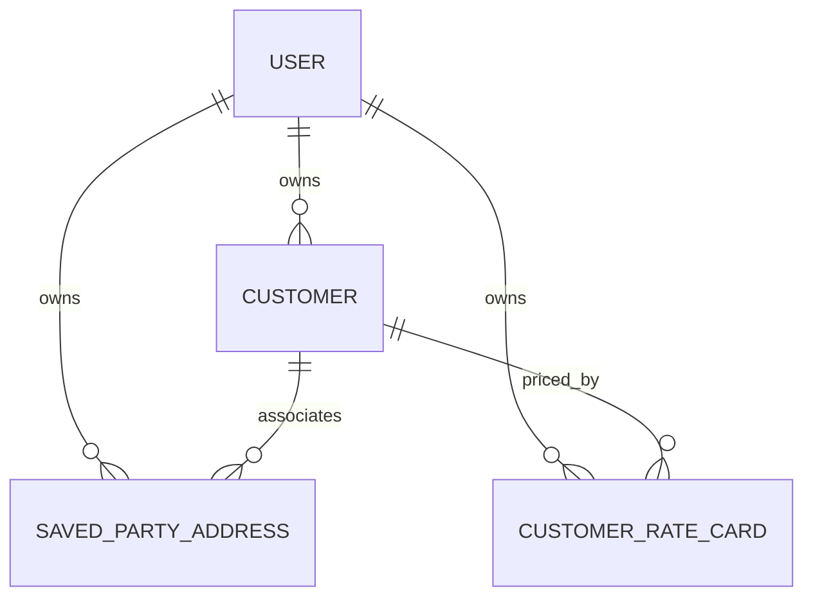

# Phase 1 – Milestone 2 Implementation Plan

**Status:** proposal for review. No application source, package file, database, shipment booking, or Delhivery integration was changed.

**Scope:** Customer Management (Credit and Walk-in), saved Shipper/Consignee/Pickup addresses, and Customer Rate Master (customer-specific and standard Walk-in cards). The SRD is the requirements source; the Phase 1 technical plan and Milestone 1 data contracts define the proposed implementation boundaries. This plan does not authorize coding until reviewed.

## 1. Requirement scope and findings

SRD Sections 3.2–3.4 define saved shipper/consignee/pickup details; Section 4 defines Credit and Walk-in customers and their profile/pricing needs; Section 5 defines rate cards and the inputs to customer selling-price calculation. This milestone establishes and manages those master records. The SRD calls for preserving the applied card and calculated charges on a shipment at booking time, but this plan respects the instruction not to change shipment booking. Booking-time snapshot integration therefore remains a separately approved follow-up; no existing booking payload or endpoint is changed here.

| Area | Current code | Milestone 1 contract | Milestone 2 gap |
|---|---|---|---|
| Customer identity | `model/model.js` is login `User` with unique email and password. No business customer model or management page. | Separate owner-scoped `Customer`, category `CREDIT` / `WALK_IN`; do not repurpose `User`. | Customer model, authenticated owner-scoped APIs, list/form/detail UX, customer reference validation. |
| Credit profile | No credit customer, billing/shipping address, terms, limit, assigned-card, monthly billing configuration, or balance master. | Store these fields, with exact rules left open. | Add conditional credit fields and mark unresolved requiredness/semantics clearly in form and API validation. No invoicing, ledger, or balance reconciliation. |
| Walk-In profile | No persisted Walk-In customer master or standard retail card. | `WALK_IN` category and a separately scoped standard card. | Support contact details and lookup/selection. Payment collection and shipment transaction records need the decisions below and remain outside booking/payment integration. |
| Party addresses | Shipment form has one-off consignee details; warehouse data is stored in browser local storage (`useSavedWarehouses.js`). No reusable shipper/consignee/pickup book. | Separate `SavedPartyAddress`, `partyType` `SHIPPER` / `CONSIGNEE` / `PICKUP`; optional `customerId`; copy “same as shipper” into a shipment only when booking is later approved. | Persist/list/edit reusable addresses with ownership and customer association. A carrier warehouse remains a separate Delhivery concept. |
| Rate cards | No rate-card model, routes, or editor. The current shipping-cost API and `CreateShipmentPage` show Delhivery carrier cost only, not the business's selling tariff. | `CustomerRateCard` with customer or Walk-In scope, effective/version data, zone/mode/weight rates, surcharges, GST rules; immutable snapshot at booking. | CRUD/editor and safe applicability lookup. Calculation can be implemented only after pricing questions are answered. |
| Auth/ownership | Express/Mongoose; `requireSession` verifies JWT and sets string `req.user.id`. `route/reportRoutes.js` demonstrates owner-filtered CRUD. | Derive `owner` from JWT; references must resolve under same owner. | Apply `requireSession` to all new APIs and filter every customer, address, card, and child lookup by owner. |
| Existing tests | Backend has `route/accountShipmentRoutes.test.js` using Node's test runner, Express, JWT, and in-memory repository fakes. Frontend has `src/services/api.test.js` and component/hook tests. | Test isolation, duplicate prevention, and compatibility. | Add new isolated route and UI/API tests; leave shipment tests and behavior intact. |

## 2. Existing functionality to reuse

### Backend

- `utils/requireSession.js` for authentication. The trusted account identifier is `req.user.id`; request bodies must never set `owner`.
- The Mongoose schema style in `model/model.js`, `model/appShipment.js`, and `model/scheduledReport.js`. Keep `User` unchanged; customer identity is a separate business concept.
- `route/reportRoutes.js` as the closest example for owner-scoped list/create/patch/delete behavior, ObjectId validation, field allowlists, response envelopes, and user-safe errors. New controllers should follow the active project's established error response convention.
- `server.js` and `route/delhiveryroutes.js` for Express mounting conventions. Add separate customer and rate-card route modules under `/api`; do not add these handlers to shipment or Delhivery routers.
- Existing `CustomerRateCard` calculations are not present. The Delhivery client in `services/delhiveryService.js` and shipping-cost controller are carrier-specific and must not be used as the customer's selling-rate authority.

### Frontend

- `src/services/api.js` is the shared fetch client, adds the session token, handles JSON/errors, and exposes named API methods. Extend it for new backend endpoints; retain every existing method and path.
- `src/components/ui/Field.jsx`, `Button`, `Modal`, `PageHeading`, `Empty`, `Pagination`, and `useApiAction.js` provide form, dialog, loading, and error patterns.
- `src/pages/warehouses/WarehousesPage.jsx` and `src/components/warehouses/WarehouseFormDialog.jsx` provide a list-plus-form-dialog pattern, but the warehouse data model and `useSavedWarehouses.js` local-storage persistence are not a substitute for server-backed customer or saved-party records.
- `src/pages/reports/ReportsPage.jsx` demonstrates authenticated CRUD UI, refresh, edit, and error handling. Reuse layout and interaction patterns; use the shared Field and page styles in the new screens.
- `src/config/navigation.js` and `src/routes/WorkspacePages.jsx` drive navigation and page dispatch. `App.jsx` already persists the selected page and token; no app-level rewrite is needed.

## 3. Proposed database design

Use three separate collections, following the Milestone 1 contract. IDs are ObjectIds. Every tenant-owned document stores `owner: String`, matching `AppShipment.owner` and `req.user.id`. The server owns the value. Store `createdAt` / `updatedAt` timestamps. Existing `User`, `AppShipment`, `PickupRequest`, and all historic records remain unchanged.

### 3.1 `Customer`

Proposed fields:

- `owner` (required, indexed); `category` (required enum `CREDIT` / `WALK_IN`).
- `companyName` and/or `displayName`; `primaryContact` object (`name`, `phone`, `email`). Requiredness, identity key, and whether individual and company customers share one representation need client confirmation.
- `gstin` (optional/conditional).
- Structured `billingAddress` (required for Credit per SRD) and `shippingAddresses` only if these are distinct from/reusable through `SavedPartyAddress` (see open decision); avoid maintaining duplicate address truth.
- `rateCardId` (reference to a card with the same owner; validate category/scope/customer match on assignment and resolution).
- Credit-only `creditTerms`, `creditLimit`, `monthlyBillingConfig`, and `outstandingBalance`, with subfield shape and source to be agreed. Balance is display/configuration data only here; do not imply a ledger or calculate from shipments.
- Contact and timestamps.

Candidate indexes: `{ owner, category, updatedAt: -1 }` for listing; optional non-unique normalized search keys. Do not enforce company, phone, or GSTIN uniqueness until the client chooses a customer identity rule. If a unique key is approved, use an owner-scoped partial unique index that excludes missing/empty values.

### 3.2 `SavedPartyAddress`

Proposed fields:

- `owner` (required, indexed), optional `customerId` (owned Customer ref), required `partyType` (`SHIPPER`, `CONSIGNEE`, `PICKUP`).
- `companyName`, `contactName`, `phone`, `email`, `addressLines`, `city`, `state`, `pincode`, optional `gstin`; conditional requiredness by party type awaits confirmation.
- Optional display label/primary flag only if the client wants these behaviors; they are not established as business rules in the SRD/M1 contract.
- timestamps.

Candidate indexes: `{ owner, customerId, partyType, updatedAt: -1 }` for customer address-book views; optionally `{ owner, partyType, pincode }` for lookup. Do not unique-index address or phone: shared contacts and addresses may be legitimate. If parties can be shared by multiple customers, replace the single `customerId` ownership relation with an explicitly approved relation model; do not silently duplicate or cross-link them.

### 3.3 `CustomerRateCard`

Proposed fields:

- `owner` (required, indexed), `scope` (`CUSTOMER` or `WALK_IN_STANDARD`), `customerId` required only for `CUSTOMER` scope, optional human-readable `name` pending UI/client approval.
- `version`, `effectiveFrom`, optional `effectiveTo`; do not infer activation or overlap policy.
- `zoneRates[]` containing an opaque client-defined `zoneCode`, `shippingMode` (`SURFACE`, `EXPRESS`), and `weightSlabs[]`. A slab needs explicit lower/upper bounds and base amount; additional-weight increment and charge fields must reflect the confirmed tariff rule. Store monetary amount with currency and decimal-safe precision, as agreed.
- `surcharges` for fuel, COD and other applicable charges; represent rule type/base only after percentage-vs-fixed, calculation order, and tax rules are confirmed.
- `gstRules` for rate, inclusion/exclusion and tax components only after tax treatment is agreed.
- timestamps; immutable version semantics after a card has been used must be agreed before enabling edits that would affect historical use.

Candidate indexes: `{ owner, scope, customerId, effectiveFrom }` for resolution; unique `{ owner, scope, customerId, version }` when versions are confirmed. Do not add “one active card” uniqueness until validity windows, walk-in cardinality, and overlap behavior are confirmed. Enforce non-overlapping rows within a card version once slab edge semantics are settled.

### 3.4 Relationships and referential invariants

- `User` is the authenticated account/owner, not the customer. Existing `User` email uniqueness remains as-is.
- Each customer, party address, and rate card is owner-scoped. A valid ObjectId alone does not authorize access.
- For all relationship reads/writes, query the referenced customer/card with both `_id` and `owner`. A customer may reference only a card from its owner; a card in `CUSTOMER` scope must reference the same owned customer. Walk-in card scope cannot have a customer ID.
- Address `customerId`, if present, must resolve to the same owner. Whether an address may be reused across customer profiles remains open.
- Customer `rateCardId` assignment is advisory until effective-date resolution rules are confirmed; resolver must return no match/ambiguous match explicitly instead of choosing arbitrarily.

## 4. API endpoint plan

Mount separate authenticated routers from `server.js`: `customerRoutes` at `/api/customers`, `savedPartyAddressRoutes` at `/api/party-addresses`, and `customerRateCardRoutes` at `/api/rate-cards`. Each router uses `requireSession`; all tenant reads/writes filter by `req.user.id`. Keep existing `/api/auth`, `/api/reports`, and `/api/delhivery` contracts and handlers unchanged.

| Method and path | Purpose and contract |
|---|---|
| `GET /api/customers?category=&search=&page=&limit=` | Owner-scoped paginated list/filter. Search fields and page limits should follow the established shipment/report API conventions. |
| `POST /api/customers` | Create a customer; strict field allowlist, category-dependent checks, card/ref owner validation. Return `201` and `{success:true,data:{customer}}`. |
| `GET /api/customers/:id` | Fetch one owned customer, optionally including its owned address summaries; return owner-safe `404` when absent/foreign. |
| `PATCH /api/customers/:id` | Partial update of allowlisted fields; validate the merged category-dependent state and all changed references. Do not allow changing `owner`, `_id`, timestamps, or password/login identity. |
| `GET /api/party-addresses?customerId=&partyType=&search=&page=&limit=` | Owner-scoped address-book search/filter; if customerId supplied, verify it belongs to owner. |
| `POST /api/party-addresses` | Create one saved party/address; validate role-specific fields and optional owned customer association. |
| `GET /api/party-addresses/:id` | Retrieve one owned saved party. |
| `PATCH /api/party-addresses/:id` | Partial edit with allowlist, owner scoping, and validation of the merged record. |
| `GET /api/rate-cards?scope=&customerId=&effectiveAt=&page=&limit=` | List/search owner cards. `effectiveAt` resolution is only deterministic after date/overlap policy is approved. |
| `POST /api/rate-cards` | Create a card/version; validate scope/customer consistency, nested row structure, currency and amounts. |
| `GET /api/rate-cards/:id` | Get one owned rate card. |
| `PATCH /api/rate-cards/:id` | Update allowed fields under the agreed draft/version policy; never mutate a card version already snapshotted by a shipment without explicit history semantics. |
| `POST /api/rate-cards/resolve` (conditional) | Read-only preview of applicable selling rate from customer/category, zone, chargeable weight, mode, payment/COD amount. Implement only after the required tariff, tax, rounding, and zone rules are approved. No shipment or database write. |

**Delete/archive policy:** the M1 contract lists CRUD as a possible API shape but does not settle hard deletion. Do not expose delete until the client chooses. Recommended default for review: retire/archive unused cards and customers, prevent deleting a record referenced by an address/card/shipment, and retain old rate-card versions. If the client requires removal, define whether deletion is hard or soft and how historical references are resolved.

**Status codes:** `400` invalid input/unknown fields; `401` absent/invalid session (existing middleware); `404` missing or not-owned record; `409` duplicate/overlap conflict after uniqueness rules are agreed; `503` persistence failure. Do not disclose whether a foreign owner's record exists. All list responses must distinguish empty success from server failure.

## 5. Frontend implementation plan

Add two management destinations to the existing `MANAGEMENT` nav group. Follow existing `WorkspaceLayout` and `WorkspacePages` dispatch; do not introduce a second app shell or alter `App.jsx` session/login behavior.

### Customer Management page

- Paginated/searchable list with Credit/Walk-In filter, name/contact/category and assigned-card indication. Empty, loading, and failure states must be distinct.
- Create/edit form with category-first conditional fields. Credit fields include billing address, shipping address access, credit terms/limit, monthly billing configuration, and card assignment as allowed by confirmed rules. Walk-In form captures contact and selected standard card behavior. Do not collect payment or create shipment transactions here until payment rules are agreed.
- Customer details view/sections for profile and saved shipper, consignee, and pickup addresses. Reuse `Modal`, `Field`, `Button`, `PageHeading`, and address form patterns; avoid confusing the existing carrier warehouse screen with a saved shipper.
- Consider a dedicated `SavedPartyAddressFormDialog` with role-specific fields; support add/edit and return updated address data to the customer page.

### Rate Master page

- List cards by scope/customer/effective range; create/edit one customer-specific or standard Walk-In card.
- Form editor for zone rows, Surface/Express and weight slabs, additional slab charges, fuel/COD/other surcharges, and GST according to the confirmed schema/rules.
- Show validation at row and card level; prevent overlapping/duplicate rate rows when semantics permit. Indicate no applicable card or ambiguity; never silently apply the first match.
- If the preview endpoint is approved, add a standalone calculator/preview UI with inputs and line-item result. This is not a booking form change.

## 6. Exact files

Paths use backend root `D:\delhivery-backebnd` and frontend root `D:\delhivery`. “Create” paths were checked against the current file inventory; none exists today.

### Backend files to create

| File | Responsibility |
|---|---|
| `model/customer.js` | Mongoose Customer schema, enum/field constraints, timestamps, candidate owner-prefixed indexes. |
| `model/savedPartyAddress.js` | Saved Shipper/Consignee/Pickup schema and owner/customer indexes. |
| `model/customerRateCard.js` | Rate-card scope, nested zone/mode/slab/surcharge/GST data, version/effective-date indexes. |
| `controller/customerController.js` | Customer list/get/create/patch and owned card/customer reference validation. |
| `controller/savedPartyAddressController.js` | Address book list/get/create/patch; owner and customer relationship checks. |
| `controller/customerRateCardController.js` | Rate-card list/get/create/patch and conditional read-only resolver endpoint. |
| `route/customerRoutes.js` | Authenticated `/api/customers` routes. |
| `route/savedPartyAddressRoutes.js` | Authenticated `/api/party-addresses` routes. |
| `route/customerRateCardRoutes.js` | Authenticated `/api/rate-cards` routes. |
| `utils/customerValidation.js` | Shared strict allowlists and customer/party shape and conditional validation, if not kept local to controllers. |
| `utils/rateCardValidation.js` | Nested rate-card validation and row conflict checks, if not kept local to controllers. |
| `services/customerRateService.js` | Pure card matching/price calculation, only after client approves zone/slab/surcharge/GST/rounding rules. |
| `route/customerRoutes.test.js` | Auth, validation, owner isolation, CRUD, reference integrity and concurrency/duplicate behavior for customer and party routes (or split if suite size warrants). |
| `route/customerRateCardRoutes.test.js` | Rate-card validation, effective-date ambiguity, owner isolation, duplicate/version/overlap and pure resolver behavior. |

### Backend files to modify

| File | Change |
|---|---|
| `server.js` | Import and mount the three new `/api` routers. No change to existing mounts/handlers. |

### Frontend files to create

| File | Responsibility |
|---|---|
| `src/pages/customers/CustomersPage.jsx` | Customer list/filter and detail entry point. |
| `src/components/customers/CustomerFormDialog.jsx` | Credit/Walk-In create/edit form. |
| `src/components/customers/SavedPartyAddressFormDialog.jsx` | Role-aware saved address create/edit. |
| `src/components/customers/CustomerAddressBook.jsx` | List/select customer-associated parties within customer detail. |
| `src/pages/rates/RateCardsPage.jsx` | Rate card list and filters. |
| `src/components/rates/RateCardFormDialog.jsx` | Customer/standard card and nested zone/slab/surcharge editor. |
| `src/components/rates/RatePreviewPanel.jsx` | Optional read-only preview UI, only if calculation rules and endpoint are confirmed. |
| `src/styles/customer-management.css` | Customer/address-book page styles if existing shared styles are insufficient. |
| `src/styles/rate-master.css` | Nested editor/table styles if existing shared styles are insufficient. |
| `src/pages/customers/CustomersPage.test.jsx` | Customer list/form states and category-dependent fields. |
| `src/pages/rates/RateCardsPage.test.jsx` | Rate list/editor states and nested validation feedback. |

### Frontend files to modify

| File | Change |
|---|---|
| `src/config/navigation.js` | Add Customers and Rate Master entries under Management. |
| `src/routes/WorkspacePages.jsx` | Import and dispatch the two new pages. |
| `src/services/api.js` | Add named customer, party-address, rate-card CRUD and (conditionally) preview methods. Keep existing methods unchanged. |
| `src/services/api.test.js` | Verify routes, JSON methods/body, query encoding, auth header, error-envelope handling for new methods. |

No changes are proposed to `package.json`, any lockfile, `AppShipment`, `services/appShipmentRouter.js`, `route/accountShipmentRoutes.js`, the existing create shipment flow, Delhivery routes/controllers/client, or current shipment request/response schemas. No app shell changes are needed in `src/App.jsx`.

## 7. Validation and test plan

### Backend validation

- Require valid JWT on every new route. Take owner only from `req.user.id`; ignore/reject owner in request payload. Verify all GET/PATCH refs with both ID and owner.
- Reject unknown fields and malformed JSON shapes; trim and bound strings; normalize email; validate phone, email, pincode and GSTIN where present. Do not invent conditional requiredness for GSTIN or fields until confirmed.
- Validate category enum; enforce the approved Credit-vs-Walk-In field/card rules. Validate merged state on PATCH (e.g. changing category cannot leave incompatible card/credit settings).
- Enforce credit-only fields only on Credit records and validate credit limit as a finite non-negative amount in agreed precision. Do not calculate outstanding balance without an approved source.
- Party type allowlist; check party-specific required fields once confirmed. Validate optional `customerId` belongs to owner; forbid cross-owner links. Test same-as-shipper only as a client-side copy helper if/when booking consumes it; it must not create an address implicitly.
- Rate card scope/customer consistency; reject foreign customer refs, empty or malformed rate rows, negative/non-finite amounts, bad date ranges, duplicate version/zone/mode/slab keys, and overlaps once inclusive/exclusive bounds are agreed. Validate surcharge and tax discriminators/values.
- Resolver (if approved) must fail explicitly on no-match or multiple-match; test zone, slab edges, additional slabs, rounding, COD, surcharge order and tax exactly against client-approved examples.
- Preserve `User` unique email behavior and legacy AppShipment records by not editing those schemas. No migration/backfill is needed for the proposed separate collections; index creation policy must be checked against deployed MongoDB and existing state.

### Backend tests (to add; do not run until implementation is authorized)

- Unauthenticated returns `401`; valid session can CRUD only its own records.
- Two users cannot read, patch, associate, or infer existence of each other's customers, addresses, or cards.
- Invalid category, unknown fields, invalid ObjectId, malformed contacts/address, invalid money, and inconsistent customer/card scope return `400` or owner-safe `404`.
- Owner-scoped reference validation for `customerId` and `rateCardId`; changing category with incompatible fields is rejected.
- Duplicate customer identity behavior follows the approved key; address duplicates are allowed unless the client chooses otherwise; rate-card version and overlapping rules follow approved policy.
- Persistence failure returns a clear service error and is not presented as an empty list.
- Pure resolver boundary tests with approved tariff fixtures (if calculation scope is approved). No carrier adapter or live Delhivery call is involved.

### Frontend tests (to add; do not run until implementation is authorized)

- API tests verify exact endpoint paths, `GET` query filters, JSON request bodies, Authorization header, loading/error behavior and unwrapped response expectations.
- Customer UI tests cover category selection, conditional credit fields, create/edit, search/filter, empty/error states, and server validation messages.
- Saved party UI tests cover all three party types, customer association, address editing, and no conflation with warehouses.
- Rate card UI tests cover scope selection, dynamic zone/slab rows, invalid/overlapping row feedback, active/effective date display, and no silent selection on ambiguity.
- If preview exists, verify read-only request/result/error states and approved expected totals. Booking UI/API tests are expressly not in scope because shipment booking must not change.

## 8. Client decisions still required

These questions come from the Milestone 1 contract and SRD Sections 3–5. They are blockers for the corresponding field rules or calculator, not permission to guess:

1. **Customer identity and Walk-In model:** Which key identifies a business customer (customer code, GSTIN, phone, combination)? Does each Walk-In shipment have a persisted individual customer, or is there one standard Walk-In account with per-shipment contact details? Which fields are mandatory for company vs individual records?
2. **Credit fields:** What values/units define credit terms? Is credit limit mandatory? Is outstanding balance sourced externally, calculated from a future ledger, or manually maintained? Which monthly billing configuration fields are needed now, separate from Phase 3 invoice generation?
3. **Customer address semantics:** Are billing/shipping addresses embedded on Customer, represented only as `SavedPartyAddress`, or both? Are shipper/consignee/pickup profiles customer-specific, owner-wide, reusable across customers, or duplicable? Which fields (contact, GSTIN, email) are required by each role?
4. **Customer/card lifecycle:** May customers/cards be deleted, or only disabled/archived? What should happen if referenced by shipments? Can a customer change category? Is a card editable after use, or must each change create a new immutable version?
5. **Rate card scope/cardinality:** Is there exactly one active standard Walk-In card per owner, or separate cards by mode/zone? Can a Credit customer have multiple cards across dates? What prevents overlapping effective ranges? What default name/display label is needed?
6. **Zones:** What is the authoritative zone list and pincode-to-zone mapping? Are zones uniform or carrier-specific? Can an operator maintain this mapping, and where is that master sourced? Section 5 requires zone pricing but SRD v1.0 does not define zone values/mapping.
7. **Weight slabs:** Units and precision; min/max inclusivity; minimum billable weight; gaps/overlaps; ceiling/floor rule; additional-weight increment and charge; whether calculation uses aggregate or per-package chargeable weight. These must be explicit before deterministic resolution.
8. **Surcharge and GST:** Fixed vs percentage charges and their bases; charge order; COD fee formula; fuel and other charge rules; taxable components, rate/inclusive-vs-exclusive GST and rounding. Confirm currency and minor-unit precision too.
9. **Walk-In immediate payment/transactions:** Which payment methods and provider/source are supported, what transaction facts are stored in Phase 1, and whether customer master CRUD can be completed before payment integration. No collection or ledger behavior is assumed in this plan.
10. **Pricing preview vs shipment booking:** May Milestone 2 expose a read-only selling-price preview before shipment booking integration? Section 5 requires saving card/charges on the shipment, but the current restriction prohibits changing booking; when should that snapshot integration be authorized?
11. **Security/search/retention:** Is the current single JWT user the only tenant/operator, or are roles required immediately? Searchable PII policy/retention for saved contacts, and audit requirements for card edits are not specified beyond SRD Section 16.

## 9. Recommended task-by-task order

1. **Review and settle contract choices** needed for model field requirements, customer/address relationship, customer identity, rate-card versions, and archive behavior. Record decisions against M1; no code until this plan is approved.
2. **Implement customer persistence/API:** add `Customer` schema and owner-scoped list/get/create/patch routes, strict allowlist/validation, card-reference placeholders as appropriate, and focused route tests. Do not change `User` or shipments.
3. **Implement saved-party persistence/API:** separate `SavedPartyAddress` model and owner-scoped list/get/create/patch routes; enforce optional customer relationship; add tests for the three roles and cross-owner rejection.
4. **Implement rate-card persistence/API:** `CustomerRateCard` schema, effective/version constraints, owner-scoped CRUD (no delete until archival policy is set), and route tests. Start with storage/validation, not invented calculation behavior.
5. **Implement pure rate resolution/preview only after answers:** define tariff rule contract with examples, implement a side-effect-free service and optional `POST /api/rate-cards/resolve`, then boundary/tax/surcharge tests. Do not call courier APIs.
6. **Build customer management frontend:** add navigation/dispatch, list and forms, conditional category fields, address book, shared API methods, and page/API tests.
7. **Build rate master frontend:** list/editor, zone/slab/surcharge/GST controls and validation states; add calculator preview only if task 5 and its endpoint are approved.
8. **Review security and compatibility:** confirm all owner filters and foreign-key checks, exercise clean database index creation in a controlled test fixture, and verify legacy login plus existing shipment list/create/update paths have no changed files/contracts. No migration should be required for new collections.
9. **Acceptance and stop point:** review CRUD, ownership, validation, and rate-card examples with the client. Keep shipment booking snapshot integration, payment collection, billing/ledger, multi-courier quotes, and live carrier behavior outside this milestone unless separately authorized.

## 10. Recommendation for the first coding task

After you review and approve this plan and settle the basic customer/address ownership and identity rules, start with the **backend Customer model and authenticated owner-scoped Customer CRUD API, plus route tests**. This creates the stable customer IDs required by saved addresses and customer-specific rate cards, while keeping changes isolated from `User`, `AppShipment`, booking, and Delhivery. Defer the rate calculator until the zone, slab, money, surcharge, and GST decisions are supplied.
